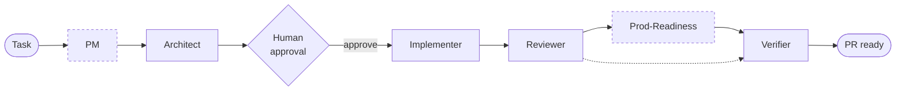

# Relay

> A six-role multi-agent pipeline for shipping frontend changes with AI assistance — tool-neutral, cache-efficient, and gated by humans at the right moments.

[](https://github.com/rgadda/frontend-eng-team/actions/workflows/ci.yml)
[](LICENSE)

> **Note:** the GitHub repo slug is `frontend-eng-team` for historical reasons. The project name is **Relay**.



> Dashed boxes are conditional. **PM** runs only for feature work (skipped for bugfix / refactor / chore / docs). **Prod-Readiness** fires only when the Architect tags the plan `sensitive:*` (auth, payments, PII, etc.).

## Why

- **One context, many roles.** Each phase runs under a focused contract (plan, implement, review, verify) instead of one agent doing everything badly.
- **Cache-friendly.** Role prompts are stable prefixes; only the task payload changes. Expect >90% cache hit on a warm session.
- **Fails closed where it matters.** Verifier defaults to FAIL. Prod-Readiness fires automatically on `sensitive:*` plans (auth, payments, PII, network, reliability).
- **Tool-neutral.** Role contracts live in `.agents/` — the same pipeline runs in Claude Code slash commands, GitHub Copilot paste workflows, or any AGENTS.md-aware tool.

## Quick start

```bash
# Once per machine
claude plugin marketplace add rgadda/frontend-eng-team --scope user
claude plugin install frontend-team@frontend-team-marketplace --scope user

# Once per target repo
cd /path/to/your-frontend-project
ft-bootstrap

# Verify
/agents    # lists five subagents
/pipeline  # runs the pipeline
```

Full setup + troubleshooting: [scripts/setup-global.md](scripts/setup-global.md).

## What's inside

| Layer | Items |
|---|---|
| **Roles** (`.agents/roles/`) | PM · Architect · Implementer · Reviewer · Prod-Readiness · Verifier |
| **Orchestrators** (`.agents/`) | `pipeline.md` (full) · `pipeline-lite.md` (small, non-sensitive changes) |
| **Subagents** (`plugins/frontend-team/agents/`) | `repo-explorer` · `frontend-reviewer` · `test-runner` · `prod-readiness` · `verifier` |
| **Skills** (`plugins/frontend-team/skills/`) | `component-conventions` · `pr-prep` · `pm-clarify` · `loop-engineering` |
| **Metrics** (`scripts/`) | `collect-pr-metrics.ts` — before/after PR velocity report |

## Usage

Run the full pipeline on a new feature:

```
/pipeline Add a UserProfile component to the settings feature
          that fetches user data via Axios and displays it
          with editable fields and form validation
```

The Architect plans, you approve, then Implementer → Reviewer → Verifier run through. One slash command, one approval gate, one PR-ready output.

For small changes:

```
/pipeline-lite Add a loading spinner to SettingsPanel while user data is fetching
```

Lite mode skips PM, Architect, and Verifier. Target cost ≤25K tokens (~55% cheaper than full). A hard entry gate refuses lite mode on any task that mentions auth / payments / PII / tokens / cookies — those always run through `/pipeline`.

**When to use which:**

| Situation | Use |
|---|---|
| New feature with user-facing behavior | `/pipeline` |
| Sensitive change (auth, payments, PII, security, reliability) | `/pipeline` — always |
| Refactor touching multiple modules or a Context / hook / effect / portal | `/pipeline` |
| Change > 200 LOC or > 3 files | `/pipeline` |
| Small bugfix, config tweak, copy change, one-file typo | `/pipeline-lite` |
| CSS-only change, docs update | `/pipeline-lite` |

## Works with

- **Claude Code** — slash commands in `.claude/commands/` (`/pm`, `/architect`, `/implement`, `/review`, `/verify`, `/pipeline`, `/pipeline-lite`).
- **GitHub Copilot in VS Code** — paste-driven workflow, see [`.github/copilot-instructions.md`](.github/copilot-instructions.md).
- **Any AGENTS.md-aware tool** — root [AGENTS.md](AGENTS.md) routes into `.agents/roles/` and `.agents/pipeline.md`.

## Tech stack this template is tuned for

React 18 · TypeScript 5 (strict) · Vite · CSS Modules · Axios · Jest + RTL · Playwright · ESLint + Prettier.

Stack-specific conventions live in [`.agents/conventions.md`](.agents/conventions.md). To adapt the template, edit that file plus `CLAUDE.md`; the role contracts themselves are stack-agnostic.

## Docs

- [Architecture + file map](docs/architecture.md) — where every file lives and why
- [Using subagents efficiently](docs/subagents.md) — when each one earns its keep
- [Adapting the template](docs/adapting.md) — making it fit your project
- [Diagrams](docs/diagrams.md) — canonical Mermaid source for every diagram
- [Copilot paste workflow](.github/copilot-instructions.md) — phase-by-phase VS Code recipe
- [PR metrics script](scripts/README.md) — portable CLI for before/after measurement
- [Framework methodology](framework.md) — the deeper paper behind the pipeline
- [Contributing](CONTRIBUTING.md)
- [Security policy](SECURITY.md)

## License

MIT — see [LICENSE](LICENSE).
