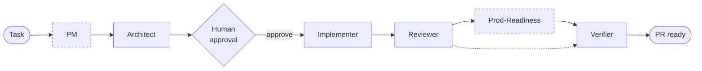
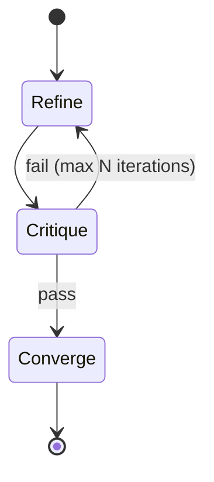
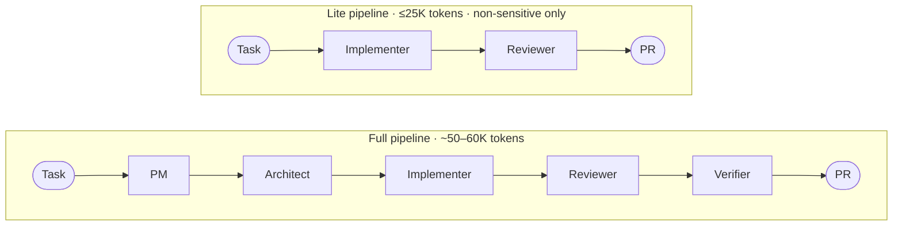
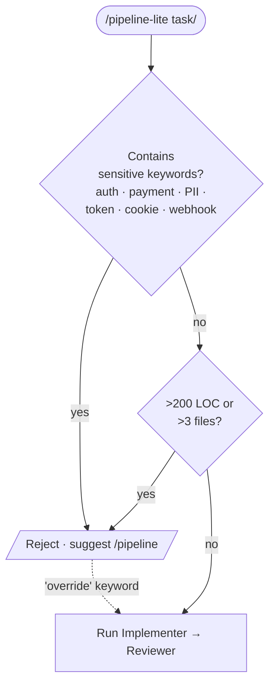

# Architecture

How Relay is organized, what each file does, and how the pieces talk to each other.

## The big picture

Relay has three layers:

1. **Role contracts** in `.agents/` — the tool-neutral source of truth. Each role is a Markdown file that defines identity, inputs, outputs, and the inner Refine-Critique-Converge (RCC) loop.
2. **Tool entry points** in `.claude/commands/`, `.github/copilot-instructions.md`, and the root `AGENTS.md` — thin wrappers that activate a role in a specific AI tool.
3. **Plugin assets** in `plugins/frontend-team/` — Claude Code subagents (forked contexts) and skills (main-context reminders), versioned and distributed via the `frontend-team-marketplace`.

The pipeline is deliberately **re-entrant from any layer**: you can invoke a single role (`/architect`), run the full pipeline (`/pipeline`), or let an AGENTS.md-aware tool route itself through the role files directly.

## Pipeline flow



- **PM** runs only for feature work. Bugfixes, refactors, chores, and docs skip PM and go straight to the Architect.
- **Approval gate** between Architect and Implementer is a hard human stop. Nothing executes without explicit `approve`.
- **Prod-Readiness** fires only when the Architect tags the plan `sensitive:*`. Non-sensitive plans flow straight from Reviewer to Verifier.
- **Verifier** defaults to FAIL and demands cited evidence against a 10-bucket checklist.

## RCC inner loop

Every role runs a bounded Refine → Critique → Converge loop before emitting its output. This is where quality compounds.



- **Refine** — produce a first draft against the role's contract.
- **Critique** — self-review against the role's checklist (format, completeness, constraints, security/SRE basics where applicable).
- **Converge** — accept and emit if critique passes; otherwise loop back to Refine, up to N iterations (usually 2–3).

The loop is bounded so a role that cannot converge **fails loudly** instead of burning tokens indefinitely.

## Lite mode

For small, non-sensitive changes (≤200 LOC / ≤3 files), `/pipeline-lite` runs Implementer → Reviewer only.



Two dedicated lite role files (`implementer-lite.md`, `reviewer-lite.md`) hold compressed contracts so lite-mode agents don't pay for the full base prompts.

**Entry gate:**



Lite mode fails closed by default. The `override` escape hatch exists for explicit user intent and is logged in the memory record.

## Memory handoffs

Every role appends a one-line JSONL summary to `.agents/memory/` at end-of-phase (`append.sh`). Downstream roles read these summaries instead of re-parsing full artifacts.

Record shape and read/write patterns are documented in [`.agents/memory/schema.md`](../.agents/memory/schema.md). Memory files are gitignored by default — they are personal workspace. Teams that want cross-developer memory can commit them at the cost of noisier diffs.

## File map

```
repo-root/
│
├── CLAUDE.md                          Auto-loaded by Claude Code on every session.
│                                      Project identity: stack, rules, constraints.
│
├── AGENTS.md                          Generic multi-tool entry point. Routes any AI
│                                      tool that follows the AGENTS.md convention into
│                                      the canonical role definitions in .agents/.
│
├── .agents/                           Canonical role definitions (source of truth).
│   ├── README.md                      Overview of how the roles are organized.
│   ├── conventions.md                 All coding conventions (TS, React, HTTP, styling,
│   │                                  testing, a11y, perf, security/SRE baselines).
│   ├── pipeline.md                    Orchestrator: phases, approval gates, RCC, loop logic.
│   ├── pipeline-lite.md               Lite orchestrator: Implementer → Reviewer only, hard
│   │                                  sensitivity gate.
│   ├── roles/
│   │   ├── pm.md                      PM role — features only (skipped for bug/refactor/chore/docs)
│   │   ├── architect.md               Architect role contract (with RCC self-critique loop)
│   │   ├── implementer.md             Implementer role contract (with RCC self-critique loop)
│   │   ├── implementer-lite.md        Implementer — Lite Mode variant (used by /pipeline-lite)
│   │   ├── reviewer.md                Reviewer role contract (with baked-in Security + SRE basics)
│   │   ├── reviewer-lite.md           Reviewer — Lite Mode variant (used by /pipeline-lite)
│   │   ├── prod-readiness.md          Prod-Readiness role — conditional (sensitive:* plans only)
│   │   └── verifier.md                Verifier role contract (10-bucket checklist)
│   └── memory/                        Persistent JSONL memory (per-developer, gitignored).
│       ├── schema.md                  Record shape + read/write patterns
│       └── append.sh                  Append helper called by every role at end-of-phase
│
├── .claude/
│   ├── commands/                      Claude Code slash-command entry points.
│   │   ├── pm.md                      /pm <task>         → reads .agents/roles/pm.md
│   │   ├── pm-clarify.md              /pm-clarify <q>    → invokes the pm-clarify skill
│   │   ├── architect.md               /architect <task>  → reads .agents/roles/architect.md
│   │   ├── implement.md               /implement         → reads .agents/roles/implementer.md
│   │   ├── review.md                  /review            → reads .agents/roles/reviewer.md
│   │   ├── verify.md                  /verify            → reads .agents/roles/verifier.md
│   │   ├── pipeline.md                /pipeline <task>       → reads .agents/pipeline.md
│   │   └── pipeline-lite.md           /pipeline-lite <task>  → reads .agents/pipeline-lite.md
│   └── settings.json                  Registers the local plugin marketplace and
│                                      auto-enables the frontend-team plugin.
│
├── .claude-plugin/
│   └── marketplace.json               Marketplace manifest (frontend-team-marketplace)
│                                      that publishes the bundled plugin.
│
├── plugins/
│   └── frontend-team/                 Versioned plugin: subagents + skills.
│       ├── .claude-plugin/plugin.json Plugin manifest (name, version).
│       ├── agents/                    Subagents (forked-context helpers).
│       │   ├── repo-explorer.md       Cheap haiku lookups: "where is X"
│       │   ├── frontend-reviewer.md   Diff review, returns structured verdict
│       │   ├── test-runner.md         Runs Jest + Playwright, summarized output
│       │   ├── prod-readiness.md      On-demand Security + SRE deep pass (haiku)
│       │   └── verifier.md            Final tsc/eslint/build gate + 10-bucket checklist
│       └── skills/                    Skills (main-context convention reminders).
│           ├── component-conventions/ React/TS/CSS/Axios/test playbook
│           ├── pr-prep/               Pre-push diff hygiene + gates
│           ├── pm-clarify/            Dev/tester PRD Q&A grounded in branch-prd.md
│           └── loop-engineering/      Reference for the RCC self-critique pattern
│
├── .github/
│   ├── copilot-instructions.md        Copilot entry point. Auto-loaded by VS Code
│   │                                  Copilot Chat. Documents the paste-driven
│   │                                  workflow that maps to the .agents/ roles.
│   ├── workflows/ci.yml               Lint + build + template-integrity CI.
│   ├── ISSUE_TEMPLATE/                Bug / feature templates.
│   └── pull_request_template.md       PR checklist.
│
├── framework.md                       The multi-agent methodology document.
├── metrics-collection.md              What metrics to collect and how.
├── pr-tracking.md                     PR-level tracking templates.
│
├── docs/
│   ├── architecture.md                This file.
│   ├── subagents.md                   Efficient subagent + skill usage.
│   ├── adapting.md                    Adapting the template to your project.
│   └── diagrams.md                    Canonical Mermaid source for every diagram.
│
├── scripts/
│   ├── ft-bootstrap.sh                Per-repo installer for the pipeline scaffolding.
│   ├── setup-global.md                Full global setup guide (plugin + bootstrap).
│   ├── collect-pr-metrics.ts          Self-contained CLI for measuring PR velocity.
│   └── README.md                      Portable usage guide for the metrics script.
│
├── CLAUDE.md · AGENTS.md
├── CONTRIBUTING.md · SECURITY.md
└── LICENSE · README.md
```

## Further reading

- [Using subagents efficiently](subagents.md)
- [Adapting the template](adapting.md)
- [Framework methodology (deep paper)](../framework.md)
