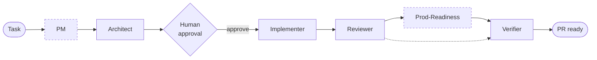
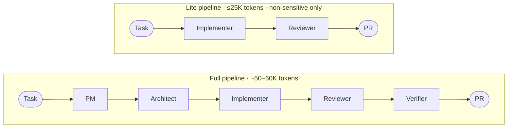
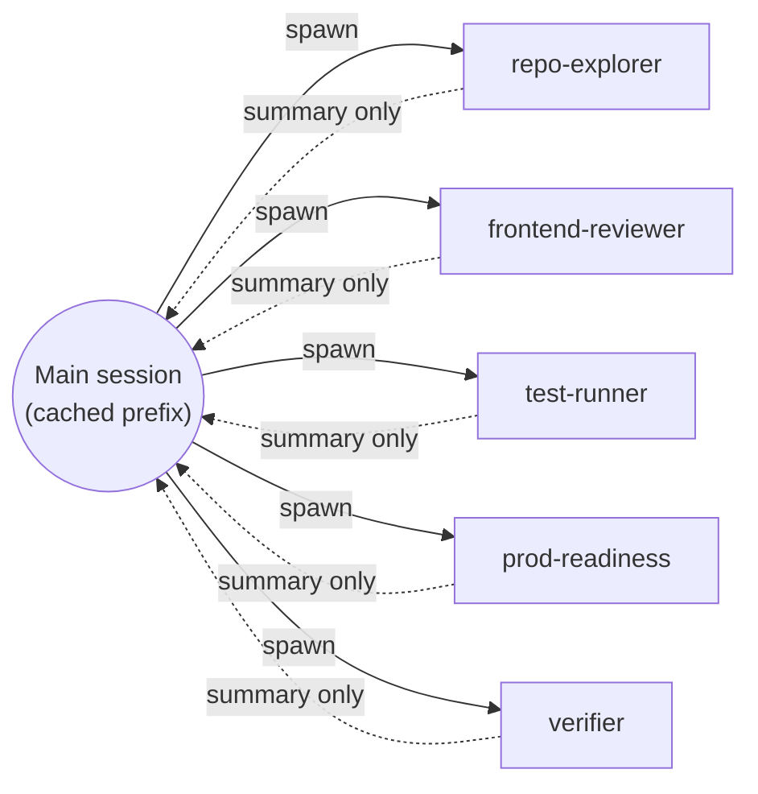
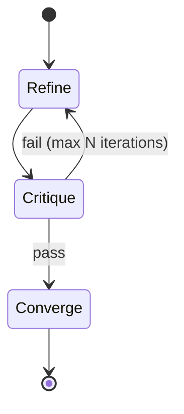
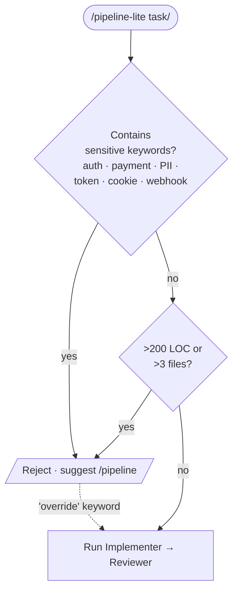

# Diagrams

Canonical Mermaid source for every diagram referenced in the README and `docs/` pages. GitHub renders Mermaid natively in Markdown fenced code blocks, so these are the final assets — not source for exports.

If you update a diagram, update it here first, then re-paste the block into the consuming file. Keeping the source in one place prevents drift.

---

## 1. Pipeline flow (README hero)

**Used in:** `README.md` hero section.

**What it shows:** the six roles end-to-end with the human approval gate between Architect and Implementer. PM and Prod-Readiness are conditional (dashed).

**Legend to pair with the diagram:**
> Dashed boxes are conditional. PM runs only for feature work. Prod-Readiness fires only on `sensitive:*` plans.

---

## 2. Full vs Lite comparison

**Used in:** `README.md` usage section, pitch decks.

**What it shows:** two parallel pipelines — full (6 roles, ~50–60K tokens) vs lite (2 roles, ≤25K tokens, non-sensitive only).

---

## 3. Context isolation (main session vs subagent forks)

**Used in:** `docs/subagents.md`.

**What it shows:** the main session stays clean; subagents fork, do read-heavy work, return summaries only.

**Legend:**
> Solid arrows carry the spawn + task. Dashed arrows carry only the compact summary back to the main session. Raw file dumps, grep output, and test logs stay inside the fork.

---

## 4. RCC inner loop (Refine → Critique → Converge)

**Used in:** `docs/architecture.md`, `.agents/README.md`.

**What it shows:** the self-critique loop every role runs, with a max iteration bound to prevent runaway cost.

---

## 5. Lite-mode entry gate

**Used in:** `docs/architecture.md` lite-mode section.

**What it shows:** the hard sensitivity check at the entrance of `/pipeline-lite`.

---

## Style conventions

- **Direction:** prefer `LR` (left-to-right) for pipelines; `TD` (top-down) for decision trees.
- **Node shapes:** `([rounded])` for inputs/outputs, `[rectangle]` for roles, `{diamond}` for decisions, `((circle))` for sessions/contexts.
- **Dashes:** solid for the happy path; dashed (`-.->`) for conditional or asymmetric edges; `stroke-dasharray` on classDef for conditional *nodes*.
- **No hex colors in classDefs.** GitHub Mermaid themes recolor based on light/dark mode; hardcoded colors break one theme or the other. Use dash patterns and labels to signal state instead.
- **Keep labels short.** Role names, not sentences. If a diagram needs a paragraph of explanation, put it in a blockquote underneath, not inside the nodes.
- **Test both themes.** Toggle GitHub to dark mode and verify every diagram is legible before shipping.
