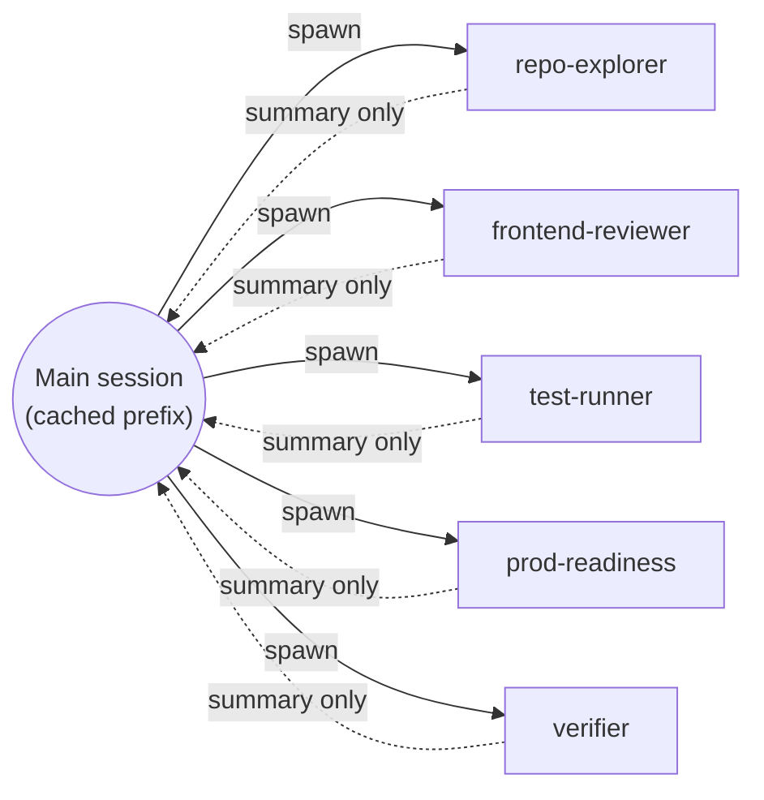

# Using subagents efficiently

The slash commands (`/architect`, `/implement`, etc.) run in the **main session** because they need `CLAUDE.md` inheritance and an interactive review surface. The subagents in the plugin run in **forked contexts** — they spin up, do read-heavy work, and return a summary. The raw file dumps, grep output, and test logs never enter the main transcript, which keeps the cache hot and the token budget healthy.

## Why forking matters

Solid arrows carry the spawn + task. Dashed arrows carry only the compact summary back. Raw file dumps, grep output, and test logs stay inside the fork.

## What each subagent is for

| Subagent | Model | When to invoke | Returns |
|---|---|---|---|
| `repo-explorer` | haiku | Before writing code, when you need to locate a file, find usages, or surface a convention example | Prioritized path list with one-line rationales |
| `frontend-reviewer` | sonnet | Explicit-invoke via `/review` — after the Implementer reports changed files | CRITICAL / RECOMMENDED / OPTIONAL / Positives / Verdict (with baked-in Security + SRE basics) |
| `test-runner` | haiku | After implementation, before the verifier gate | Pass/fail counts, failed test names, one-line cause, repro command |
| `prod-readiness` | haiku | Between Reviewer and Verifier, **only** when the plan carries a `sensitive:*` tag | 10-item Security + SRE checklist + PASS / CONCERNS / BLOCK verdict |
| `verifier` | sonnet | Before PR or merge — the final gate | Binary PASS/FAIL + prioritized issue list against a 10-bucket checklist (FAIL expands sub-item detail); defaults to FAIL |

## How to activate them

Each subagent's `description` field declares trigger keywords. In Claude Code, phrase your request to match — the orchestrator auto-routes without an explicit `@agent` call:

- "**find** the auth context provider" → `repo-explorer`
- "**review the diff**" / "**code review**" / "**check the changes**" → `frontend-reviewer`
- "**run tests**" / "**run jest**" / "**are tests green**" → `test-runner`
- "**prod readiness**" / "**security check**" / "**sensitive change**" → `prod-readiness`
- "**verify**" / "**ready to ship**" / "**final check**" → `verifier`

`prod-readiness` is deliberately on-demand — the pipeline invokes it automatically when the Architect tags the plan `sensitive:*`; you rarely call it by hand.

You can also call them explicitly: *"Have repo-explorer find every place that uses the Axios client."*

## Efficiency rules

1. **Use `repo-explorer` (haiku) for lookups instead of grepping yourself.** Broad "where is X" questions burn main-context tokens on raw file output. A haiku subagent answers for ~10× less cost and returns only the path list.
2. **Run independent subagents in parallel.** If you need a diff review and a test run after the same change, fire both in one turn. They don't share state.
3. **Don't fork for trivial work.** A one-file typo fix is faster done in the main session than handed to a subagent — the fork overhead exceeds the savings.
4. **Don't try to override subagent conventions mid-task.** Subagents do **not** inherit `CLAUDE.md`; the conventions they enforce are inlined in their system prompt. If a rule needs to change, edit the subagent file and bump the plugin version — don't argue with them in chat.
5. **Keep `description` fields stable.** Subagent descriptions form part of the cached prompt prefix. Changing wording invalidates the cache for every session that uses the plugin. Edit deliberately, bump the plugin version, and let teams re-pull.
6. **Treat the verifier as the gate, not as feedback.** It defaults to FAIL and demands cited evidence. Don't invoke it mid-implementation to "see how we're doing" — that wastes a sonnet run. Invoke it once when you believe you're done.
7. **Watch `/context` after a long session.** If the budget is tight, prefer subagents over main-session reads for the next chunk of work.

## Skills vs. subagents — when to use which

Skills (`component-conventions`, `pr-prep`, `pm-clarify`, `loop-engineering`) run **in the main context** with no fork. They are convention reminders, playbooks, and Q&A helpers — not workers. Use them when you want the rules loaded into your active session (e.g., right before writing a new component, opening a PR, or answering a scope question from a dev/tester). Use subagents when you want work done **without polluting the main transcript**.

Skill triggers at a glance:

- **`component-conventions`** — "new component", "create hook", "refactor component"
- **`pr-prep`** — "open PR", "ready to ship", "before I push", "PR description"
- **`pm-clarify`** — "clarify", "what does the PRD say", "is this in scope"
- **`loop-engineering`** — "add self-critique", "add RCC loop", "iterate the plan"
